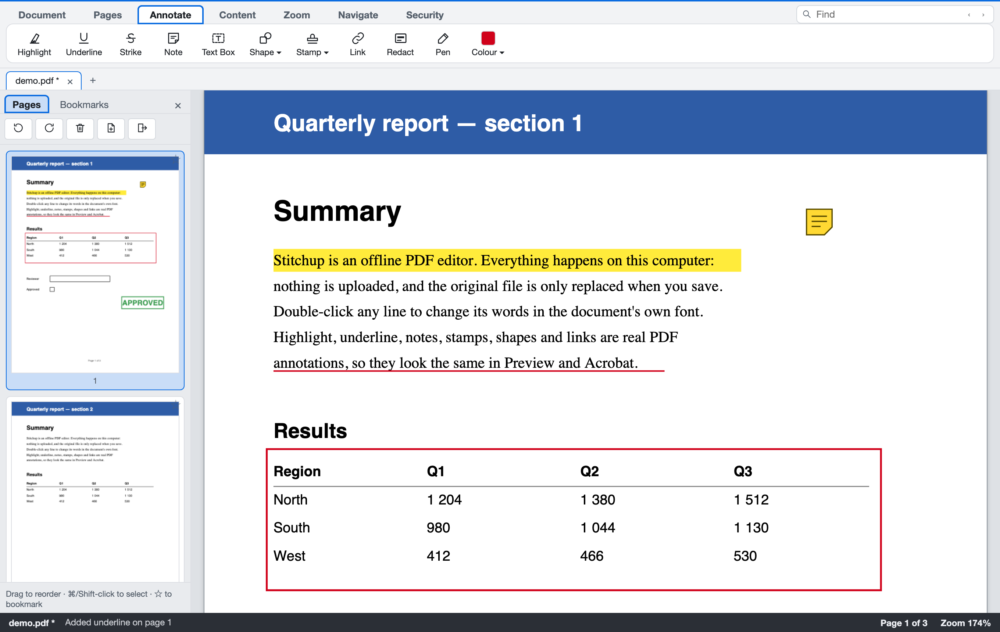
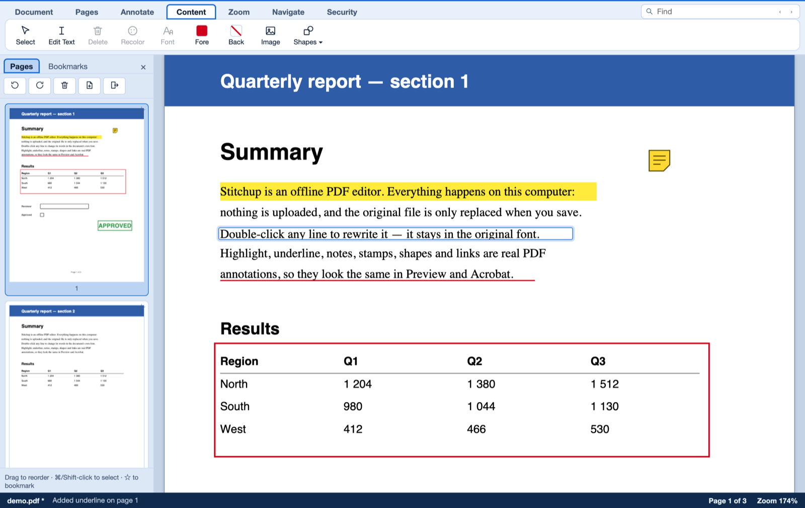
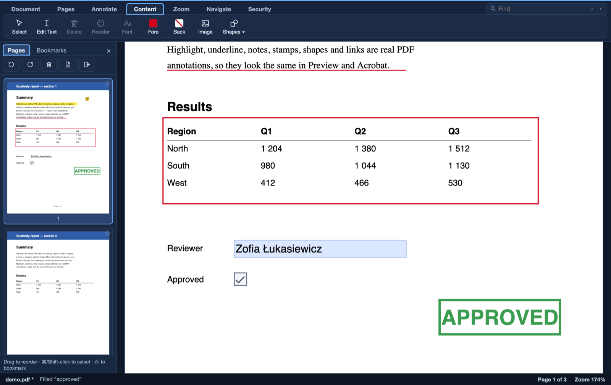
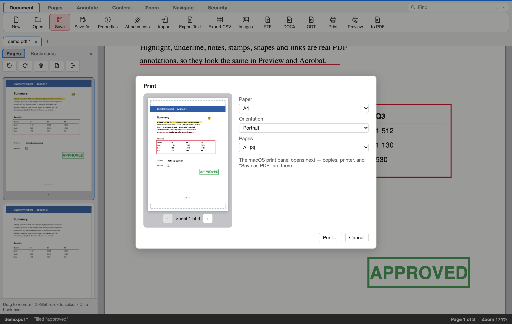
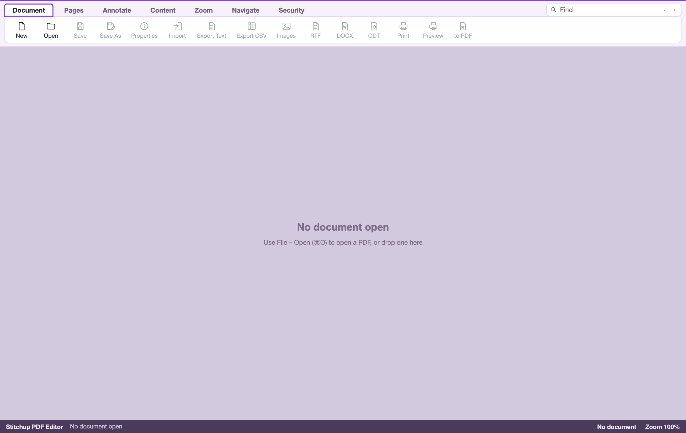
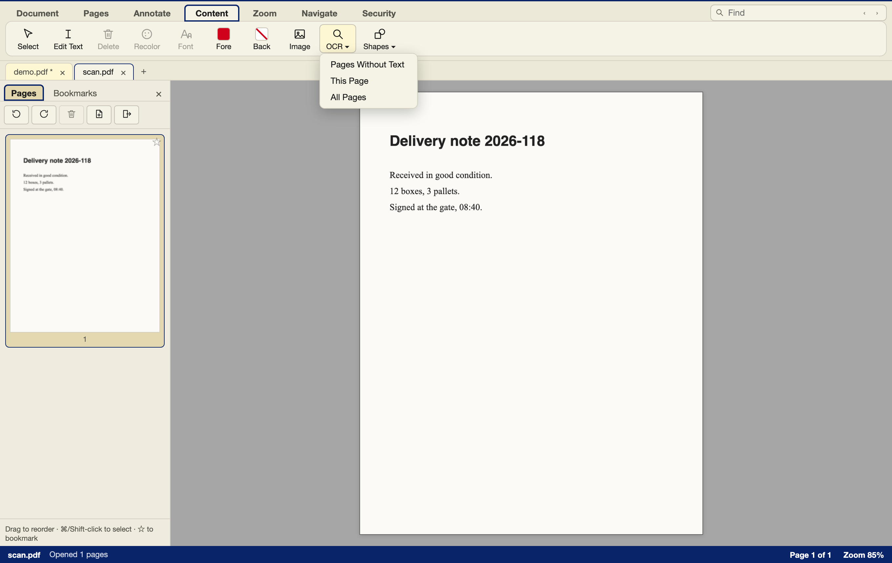
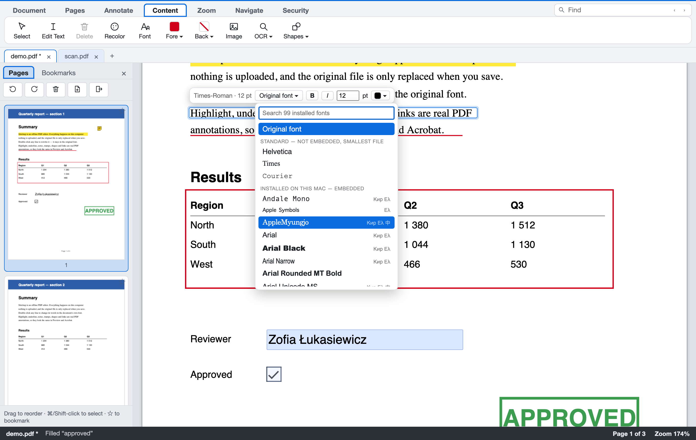

# Stitchup for macOS

An offline PDF viewer and editor for macOS (Apple Silicon and Intel). Same
ribbon, menus and colour schemes as the Windows build
([stitchup-Win](https://github.com/Kafaferanterenous/stitchup-Win)).
Everything runs on your Mac. Nothing is uploaded, and your file is only
replaced when you save.



| | |
|---|---|
|  |  |
| Double-click any line to rewrite it in the document's own font | Fill PDF forms; the values show in Preview and Acrobat too |
|  |  |
| Print preview with paper size and orientation | Nine colour schemes, the same as on Windows |
|  |  |
| Tabs for open documents; OCR makes scanned pages searchable | Any installed font for a line, shown in its own typeface |

## Download

Get the latest `Stitchup-macOS-universal-*.zip` from
[Releases](https://github.com/Kafaferanterenous/stitchup-MacOS/releases),
unzip it and drag **Stitchup.app** to Applications. The app is ad-hoc signed,
not notarized. The first time you open it, right-click it and choose
**Open**, or run `xattr -dr com.apple.quarantine Stitchup.app`.

## What it does

- **Edit text in place:** double-click a line, or use Content ▸ Edit Text. The
  text is changed in the PDF in the original font. If that font lacks a letter,
  the line is redrawn in the closest standard font, with full Polish and other
  Central European letters (ą ć ę ł ń ó ś ź ż). Letters no standard font
  has (Cyrillic, Greek, Chinese, Japanese…) are set in an installed font of
  the same style. Arabic and Hebrew (right to left), Hindi and other Indic
  scripts, and Thai are shaped properly: letters join, conjuncts form, and
  marks sit in the right place. While you edit, a bar above the line shows its font and
  size and lets you change font, bold, italic, size and colour. Any font
  installed on your Mac can be used; only the letters used are embedded.
- **Annotate:** highlight, underline and strike-out snap to the text. Also
  sticky notes, text boxes, shapes (rectangle, oval, line, arrow), stamps,
  links and freehand pen. All are real PDF annotations, so they look the same
  in Preview and Acrobat.
- **Redact:** what is under the box is removed from the file, not just covered.
- **Content tools:** select, move and delete text, images, shapes (lines,
  rectangles, filled areas) and annotations — also inside grouped drawings,
  where text can be edited in place too.
  Recolour selected text, shapes and existing annotations.
  Recolour text, change its font and size, insert images (PNG with
  transparency, JPEG, HEIC…) and draw vector shapes.
- **Forms:** fill text fields, checkboxes, radio buttons and drop-downs.
- **OCR:** Content ▸ OCR reads scanned pages with Apple's Vision framework, on
  your Mac (macOS 10.15 or later), and adds the text as an invisible layer.
  The page looks the same, but you can now search, select and copy its text.
- **Tabs:** each open document gets its own tab, with its own page, zoom and
  undo (⌘T, ⌘W, ⌃Tab). Drag a page thumbnail onto another tab to move the page.
- **Pages:** rotate, delete, add, drag to reorder, multi-select, extract,
  split, merge, import, combine, and auto-crop.
- **Security:** AES-256 password protection, watermarks, and digital signatures
  (RSA-2048 / SHA-256 PKCS#7, verifiable with OpenSSL). Signing an already
  signed PDF, or saving changes to it, adds an incremental update, so earlier
  signatures stay valid.
- **Safety:** quitting with unsaved changes asks first. Optional crash-recovery
  snapshots (File ▸ Settings, ⌘,) bring unsaved work back after a crash.
- **Export:** Text, CSV, RTF, DOCX, ODT, and PNG or JPEG images. Print with
  preview; "Save as PDF" is in the macOS print panel. Compress PDF, with
  oversized images made smaller (150, 300 or 96 dpi).
- **Navigation and viewing:** find (⌘F, F3), thumbnails, bookmarks, single,
  spread and continuous views, zoom and fit, unlimited undo and redo, and
  the nine Windows colour schemes. Open by double-clicking in Finder, by
  dragging onto the window, or from the Dock.

Progress against the Windows build: [GOALS.md](GOALS.md).

## Build

Requirements: Rust (stable), Node.js 20 or later, and the Xcode Command Line Tools.

```sh
./build-macos.sh           # all tests + universal app → dist/Stitchup.app and a zip
./build-macos.sh --quick   # app only
```

Tests:

| Command | What it checks |
|---|---|
| `cd source/core && cargo test --release` | PDF engine: text editing, annotations, redaction, forms, signatures (checked with OpenSSL), page tree |
| `cd source/app/src-tauri && cargo test --release` | Command layer |
| `cd source/app && npm run build && npm run test:e2e` | 77 end-to-end checks: the real UI in Chromium driving the real Rust backend, with every ribbon tab, dialog and shortcut |

## Layout

```
source/core/            Rust PDF engine (lopdf): textedit, annots, objects (redaction),
                        forms, sign, docops, ops (pages), oplog (undo/redo)
packaging/ocr/          Swift OCR helper (Apple Vision), bundled inside the app
source/app/             Tauri 2 + React/TypeScript UI (pdf.js renderer)
  src/commands.ts       every ribbon button, menu item and shortcut, defined once
  src-tauri/            commands; examples/dev_bridge.rs serves the e2e tests
fixtures/generated/     test PDFs (F-01…F-14)
docs/                   design notes, dependency ledger, screenshots
```

## Licences

Built on Tauri, React, PDF.js, lopdf, dnd-kit and RustCrypto (all MIT or
Apache-2.0). The list is under File ▸ About & Licenses and in
`docs/STAGE0_DEPENDENCY_LEDGER.md`.
